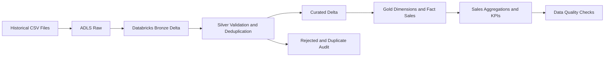
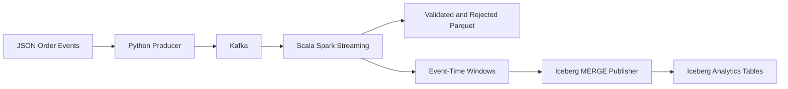

# PROJECT NEXUS Architecture

## Pipeline A: Historical Batch Processing

## Pipeline B: Real-Time Processing

## Deployment

Batch: Azure Databricks + ADLS Gen2 + Delta Lake.

Streaming: local Docker/Kubernetes + Kafka + Spark + Iceberg.

These are separate demonstrated pipelines; automatic integration
of historical and real-time order state is a future enhancement.
