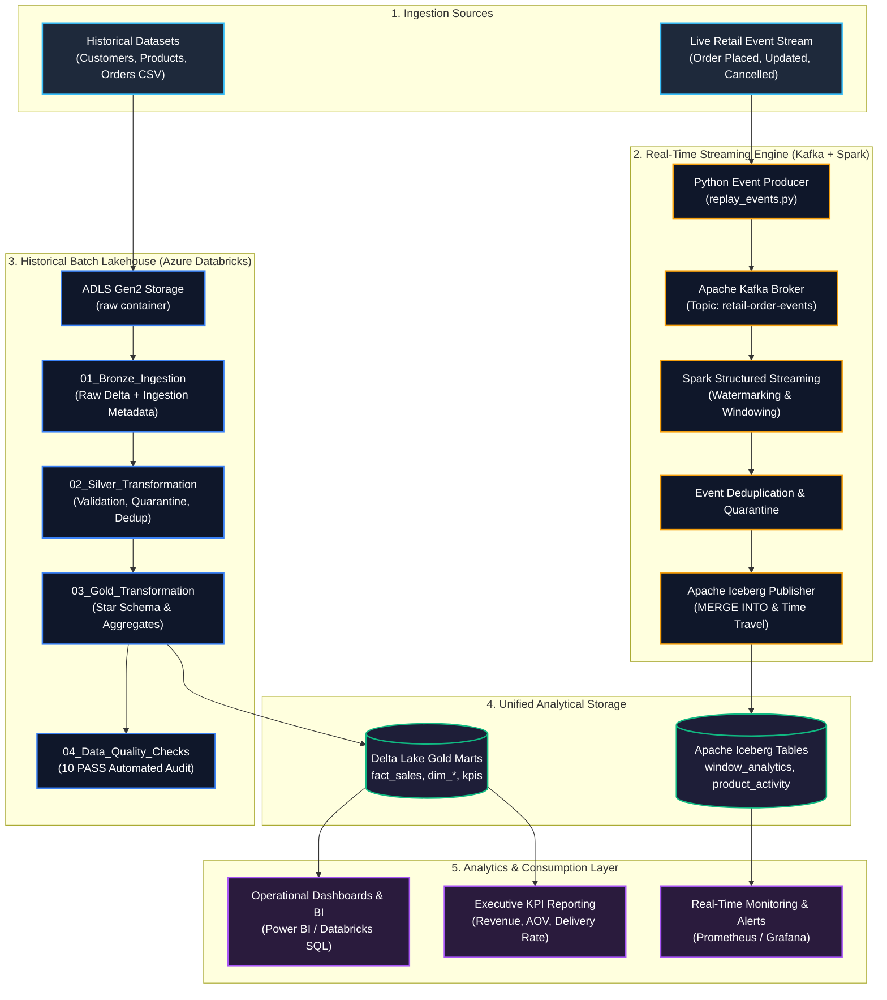
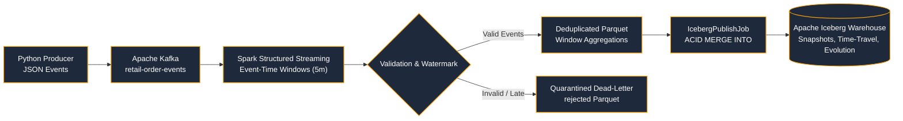
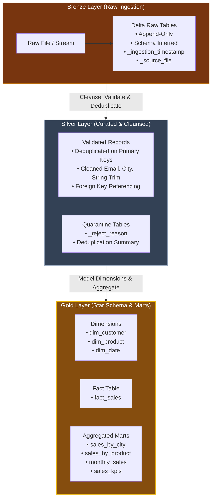
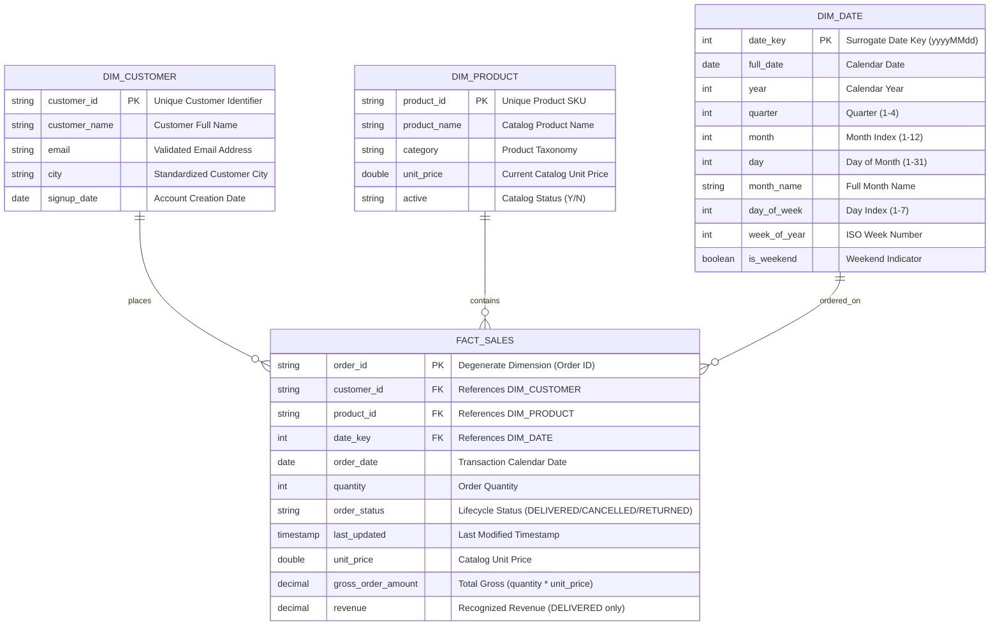
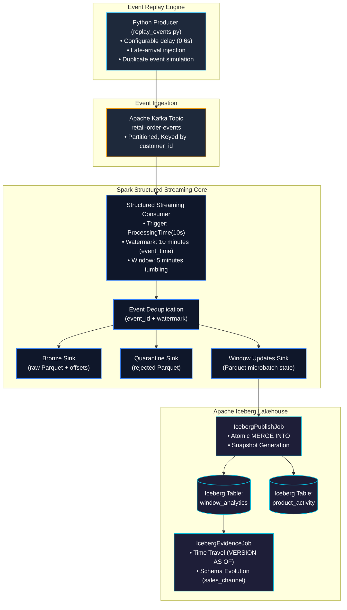
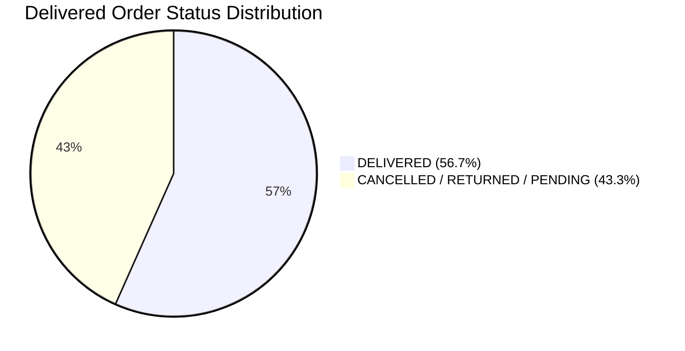

# 🚀 PROJECT NEXUS: Unified Retail Intelligence & Real-Time Data Platform

> **End-to-End Enterprise Retail Data Engineering Platform featuring a Dual-Engine Architecture: Historical Lakehouse Batch Processing on Azure Databricks with Delta Lake, and High-Throughput Real-Time Event Streaming on Apache Spark, Apache Kafka, and Apache Iceberg with Docker & Kubernetes.**

---

[](.github/workflows/ci.yml)
[](https://spark.apache.org/)
[](https://kafka.apache.org/)
[](https://delta.io/)
[](https://iceberg.apache.org/)
[](https://azure.microsoft.com/services/databricks/)
[](Real_Time_Streaming/k8s/)

---

# 📌 Project Overview

**PROJECT NEXUS** is an enterprise-grade retail intelligence platform designed to handle both large-scale historical transaction processing and low-latency real-time order streams. It combines the reliability and analytical depth of the **Medallion Lakehouse Architecture (Delta Lake)** on Microsoft Azure with the high-throughput, low-latency responsiveness of **Apache Kafka, Spark Structured Streaming, and Apache Iceberg**.

### 🌟 Key Platform Capabilities:
- **Dual-Engine Architecture:** Parallel processing pipelines for historical batch analytics (Azure Databricks) and real-time order lifecycle streaming (Kafka + Spark).
- **Medallion Lakehouse Pattern:** Robust Multi-Hop data curation spanning **Bronze** (Raw ingestion & audit lineage), **Silver** (Cleansing, deduplication, schema validation & quarantine), and **Gold** (Star Schema dimensional modeling & aggregated business marts).
- **Modern Open Table Formats:** Native support for **Delta Lake** (ACID transactions, time-travel, optimized writes) and **Apache Iceberg** (atomic `MERGE INTO`, snapshot isolation, hidden partitioning, and schema evolution).
- **Real-Time Event Processing:** Sub-second micro-batch ingestion, event-time windowing (5-minute tumbling windows), 10-minute watermark thresholding, and stateful deduplication.
- **Enterprise Star Schema:** Dimensional data model (`Dim_Customer`, `Dim_Product`, `Dim_Date`, and `Fact_Sales`) powering downstream executive BI and operational KPIs.
- **Automated Data Quality & Lineage:** 10-point rigorous Data Quality test suite with automated mathematical reconciliation ($230 = 146\text{ valid} + 70\text{ rejected} + 14\text{ duplicate extras}$).
- **Containerized & Cloud-Native Deployment:** Multi-stage non-root Docker images, Kubernetes production manifests (Deployments, Services, ConfigMaps, PVCs), and CI/CD via GitHub Actions.

---

# 🏛 High-Level System Architecture

PROJECT NEXUS unifies historical retail records and live telemetry into a decoupled, scalable, and resilient data platform.



---

# 🔄 End-to-End Pipeline Flows

### Pipeline A: Historical Batch Lakehouse Pipeline

```mermaid
flowchart LR
    CSV["Historical CSVs<br/>(Customers, Orders, Products)"]
    --> ADLS["Azure ADLS Gen2<br/>abfss://raw@"]
    --> BRONZE["Bronze Layer (Delta)<br/>Schema Enforcement & Audit Lineage"]
    --> SILVER["Silver Layer (Delta)<br/>Cleansing & Dead-Letter Quarantine"]
    --> GOLD["Gold Layer (Delta)<br/>Star Schema Dimensions & Fact"]
    --> MARTS["Aggregated Marts<br/>City, Product, Monthly, KPIs"]
    --> DQ["Automated Data Quality<br/>10/10 PASS Check Suite"]

    classDef stage fill:#1e293b,stroke:#0ea5e9,stroke-width:1.5px,color:#fff;
    class CSV,ADLS,BRONZE,SILVER,GOLD,MARTS,DQ stage;
```


### Pipeline B: Low-Latency Streaming Pipeline


---

# 🛠 Technology Stack

| Category | Technology | Usage in PROJECT NEXUS |
|:---|:---|:---|
| **Cloud Provider** | **Microsoft Azure** | Cloud storage, managed compute, and Lakehouse infrastructure |
| **Object Storage** | **Azure Data Lake Storage Gen2 (ADLS)** | Scalable multi-container Lakehouse backend (`raw`, `bronze`, `curated`, `analytics`, `rejected`) |
| **Batch Compute** | **Azure Databricks** | Distributed processing, Delta Lake optimization, scheduled workflow orchestration |
| **Stream Compute** | **Apache Spark 3.5 (Structured Streaming)** | Stateful stream processing, event-time watermarking, and tumbling window analytics |
| **Message Broker** | **Apache Kafka** | Real-time event ingestion and partitioned distributed streaming log |
| **Table Formats** | **Delta Lake & Apache Iceberg** | Dual ACID open table formats supporting time-travel, schema evolution, and upserts |
| **Core Languages** | **Scala 2.12 & Python 3.10+** | Scala for enterprise Spark/sbt pipelines; Python for Kafka event simulation and CLI validation |
| **Build Tooling** | **sbt (Scala Build Tool)** | Modular compilation, dependency management, and automated test execution |
| **Containerization** | **Docker & Docker Compose** | Multi-stage non-root container images and local multi-service testing environment |
| **Orchestration** | **Kubernetes (K8s)** | Production manifests for Spark streaming consumer and Kafka publishers |
| **CI / CD** | **GitHub Actions** | Automated build verification, ScalaTest execution, and container build validation |
| **Data Quality** | **ScalaTest & Custom Audit Suite** | Automated mathematical reconciliation, primary/foreign key validation, and business rule enforcement |

---

# 📂 Project Structure

```
PROJECT_NEXUS_Retail_Intelligence_Real-Time_Data_Analytics/
├── .github/
│   └── workflows/
│       └── ci.yml                          # Continuous Integration & build validation
├── Architecture/                           # Architectural diagrams & Star Schema
│   ├── Dashboard_Charts_1.png
│   ├── Dashboard_Charts_2.png
│   ├── Star_Schema.png
│   └── README.md
├── Batch Processing/                        # Azure Databricks Medallion Lakehouse Notebooks
│   ├── Databricks_Notebooks/
│   │   ├── 01_Bronze_Ingestion.scala       # ADLS Gen2 raw -> Bronze Delta tables
│   │   ├── 02_Silver_Transformation.scala  # Cleansing, quarantine & deduplication
│   │   ├── 03_Gold_Transformation.scala    # Kimball Star Schema & business marts
│   │   └── 04_Data_Quality_Checks.scala    # 10-point automated DQ verification
│   └── README.md
├── Datasets/                               # Raw & incremental sample retail data
│   └── nexus/
│       ├── batch/                          # Historical CSVs (customers, orders, products, updates)
│       └── streaming/                      # Micro-batch JSON & Kafka keyed payloads
├── Logging/                                # Pipeline run logs & audit evidence
│   └── Execution_Evidence/
│       └── README.md                       # Batch & streaming verification evidence
├── Real_Time_Streaming/                    # Dedicated end-to-end Real-Time Streaming module
│   ├── docker/                             # Container specifications
│   │   ├── Dockerfile.producer
│   │   └── Dockerfile.streaming
│   ├── k8s/                                # Kubernetes production manifests
│   │   ├── 00-namespace.yaml
│   │   ├── 10-infra.yaml
│   │   ├── 15-secrets-empty.yaml
│   │   ├── 20-workloads.yaml
│   │   └── k8s-optional-publisher.yaml
│   ├── producer/                           # Python Kafka event replayer
│   │   └── replay_events.py
│   ├── project/                            # sbt build properties
│   │   └── build.properties
│   ├── scripts/                            # Verification & run scripts
│   │   ├── check_sample.py
│   │   └── run_iceberg_in_docker.sh
│   ├── src/                                # Streaming engine & Iceberg publishers
│   │   ├── main/scala/com/nexus/
│   │   │   ├── EventTransforms.scala
│   │   │   ├── IcebergEvidenceJob.scala
│   │   │   ├── IcebergPublishJob.scala
│   │   │   ├── InspectOutputs.scala
│   │   │   ├── StreamingJob.scala
│   │   │   └── VerifyStreamingOutput.scala
│   │   └── test/scala/com/nexus/
│   │       └── EventTransformsSpec.scala
│   ├── build.sbt                           # Dedicated sbt build
│   ├── compose.yaml                        # Streaming orchestration compose
│   ├── requirements.txt                    # Python runtime requirements
│   └── README.md
├── Testing/                                # Unit tests, schema checks & CI guidelines
│   ├── CI_CD_README.md                     # CI/CD operational guide
│   └── README.md
├── docs/                                   # Platform documentation & design matrices
│   ├── delta-vs-iceberg.md                 # Table format evaluation
│   ├── local-streaming-guide.md            # Developer execution runbook
│   ├── requirements-matrix-streaming-initial.md
│   ├── requirements-matrix.md              # Requirements traceability
│   ├── requirements-traceability.md
│   └── star-schema-mapping.md              # Data dictionary & dimensional mappings
├── .dockerignore
├── .gitignore
└── README.md
```

---

# 📊 Datasets & Schemas

PROJECT NEXUS operates on two distinct data workloads:

### 1. Historical Batch Datasets (`Datasets/nexus/batch/raw/`)
- **`customers.csv`:** Customer demographics (`customer_id`, `customer_name`, `email`, `city`, `signup_date`).
- **`products.csv`:** Product catalog (`product_id`, `product_name`, `category`, `unit_price`, `active`).
- **`orders.csv`:** Transaction records (`order_id`, `customer_id`, `product_id`, `quantity`, `order_date`, `order_status`, `last_updated`).
- **`orders_updates.csv` & `orders_v2.csv`:** Incremental updates and evolved schema batches for change data capture testing.

### 2. Real-Time Streaming Events (`Datasets/nexus/streaming/`)
- **`order_events.jsonl`:** Continuous retail event streams containing 62 verified micro-messages.
```json
{
  "event_id": "EVT-2026-11-19-001",
  "event_type": "ORDER_CREATED",
  "order_id": "ORD-2026-1001",
  "customer_id": "CUST-001",
  "product_id": "PROD-005",
  "quantity": 2,
  "unit_price": 2499.00,
  "event_time": "2026-11-19T10:15:30Z",
  "ingest_time": "2026-11-19T10:15:31.250Z"
}
```

---

# 🏛 Medallion Architecture Deep Dive

The Medallion Architecture ensures enterprise data reliability through progressive data refinement across three distinct tiers:



### Layer Specifications:
1. **Bronze Layer (`abfss://bronze@...`):**
   - Ingests raw data without destructive modifications.
   - Preserves lineage with `_ingestion_timestamp` and `_source_file`.
   - **Tables:** `bronze/customers`, `bronze/orders`, `bronze/products`.
2. **Silver Layer (`abfss://curated@...` & `abfss://rejected@...`):**
   - Cleanses strings, standardizes casing (`initcap`, `lower`, `upper`).
   - Enforces referential integrity and strict null checks.
   - Dual-path routing: Clean records write to curated tables; malformed records are quarantined in `rejected/` with descriptive `_reject_reason` codes (`INVALID_EMAIL`, `INVALID_QUANTITY`, `INVALID_CUSTOMER_ID`).
   - Deduplication using window ranking over `last_updated`.
   - **Tables:** `curated/customers`, `curated/orders`, `curated/products`, `rejected/orders`, `rejected/customers`, `rejected/products`.
3. **Gold Layer (`abfss://analytics@...`):**
   - Business analytics layer structured according to Ralph Kimball's dimensional modeling technique.
   - Implements business logic (e.g., revenue recognition strictly tied to `order_status = 'DELIVERED'`).
   - **Tables:** `dim_customer`, `dim_product`, `dim_date`, `fact_sales`, `sales_by_city`, `sales_by_product`, `monthly_sales`, `sales_kpis`.

---

# ⭐ Star Schema & Dimensional Modeling

The analytical core of PROJECT NEXUS is modeled as a high-performance **Star Schema** optimized for OLAP query patterns:



### Table Definitions & Grain
- **`FACT_SALES` (Grain: One row per order line):**
  - **Foreign Keys:** `customer_id`, `product_id`, `date_key`.
  - **Degenerate Dimension:** `order_id`.
  - **Measures:** `quantity`, `gross_order_amount`, `revenue`.
  - **Business Rules:** Revenue is recognized *strictly* for orders where `order_status = 'DELIVERED'`. Cancelled, Pending, or Returned orders record `0.00` recognized revenue while preserving `gross_order_amount` for pipeline loss analysis.

---

# ⚡ Real-Time Streaming & Apache Iceberg Deep Dive



### Key Streaming Capabilities Demonstrated:
1. **Event-Time Watermarking:** Handles out-of-order and late-arriving events within a 10-minute watermark window without state explosion.
2. **ACID MERGE INTO:** Publishes window summaries and product-level updates atomically into Apache Iceberg without duplicating window counts.
3. **Time-Travel & Snapshot Isolation:** Queries past snapshots using Iceberg's `VERSION AS OF` syntax, enabling reproducible audit trials.
4. **Schema Evolution:** Demonstrates seamless schema migration by dynamically adding `sales_channel` to Iceberg tables without table rewriting or service downtime.

---

# ✅ Data Quality & Automated Reconciliation

The data quality framework guarantees strict mathematical reconciliation across every hop of the Medallion pipeline.

### Mathematical Reconciliation Equation:
$$\text{Bronze Records (230)} = \text{Silver Valid (146)} + \text{Quarantined Rejected (70)} + \text{Duplicate Extras (14)}$$

```
Total Bronze Ingested: 230
├── Silver Curated:    146 (63.5%)
├── Quarantined:        70 (30.4%)
└── Removed Extras:     14 (6.1%)
```

### 10-Point Data Quality Audit Suite (`04_Data_Quality_Checks.scala`):

| # | Check Name | Target Layer | Verification Rule | Result |
|:---|:---|:---|:---|:---:|
| **DQ-01** | `bronze_silver_reconciliation` | Bronze → Silver | $\text{Bronze} = \text{Silver} + \text{Rejected} + \text{Duplicate Extras}$ | <kbd>PASS</kbd> |
| **DQ-02** | `silver_customers_unique` | Silver Curated | Primary key `customer_id` is non-null & 100% unique | <kbd>PASS</kbd> |
| **DQ-03** | `silver_products_unique` | Silver Curated | Primary key `product_id` is non-null & 100% unique | <kbd>PASS</kbd> |
| **DQ-04** | `silver_orders_unique` | Silver Curated | Primary key `order_id` is non-null & 100% unique | <kbd>PASS</kbd> |
| **DQ-05** | `silver_gold_order_reconciliation` | Silver → Gold | Silver Orders count matches Gold Fact Sales (90 rows) | <kbd>PASS</kbd> |
| **DQ-06** | `city_revenue_reconciliation` | Gold Marts | City aggregated revenue matches Fact Sales total revenue | <kbd>PASS</kbd> |
| **DQ-07** | `product_revenue_reconciliation`| Gold Marts | Product aggregated revenue matches Fact Sales total revenue | <kbd>PASS</kbd> |
| **DQ-08** | `monthly_revenue_reconciliation`| Gold Marts | Monthly aggregated revenue matches Fact Sales total revenue | <kbd>PASS</kbd> |
| **DQ-09** | `kpi_revenue_reconciliation` | Gold Marts | Executive KPI revenue matches Fact Sales total revenue | <kbd>PASS</kbd> |
| **DQ-10** | `revenue_business_rule` | Gold Fact Sales | Zero recognized revenue on non-delivered orders | <kbd>PASS</kbd> |

---

# 📈 Business KPIs & Analytical Marts

From 90 curated fact transactions, the Gold layer computes executive-ready business metrics:



| Metric Name | Business Value | Operational Context |
|:---|:---|:---|
| **Total Curated Orders** | **90** | Total validated orders in the dimensional warehouse |
| **Delivered Orders** | **51** | Orders successfully fulfilled |
| **Delivery Success Rate** | **56.67%** | Delivered orders divided by total orders |
| **Total Recognized Revenue** | **₹253,287.00** | Recognized strictly on fulfilled deliveries |
| **Average Order Value (AOV)**| **₹4,966.41** | Average revenue per delivered order |
| **Units Sold** | **128 Units** | Total item volume across delivered transactions |
| **Active Customer Base** | **23 Customers** | Transacting customers across active markets |
| **Catalog Breadth** | **10 Products** | High-velocity product categories represented |

---

# 🚀 How to Run & Execute

### Prerequisites
- **JDK 17+** & **sbt 1.10+**
- **Python 3.10+**
- **Docker Desktop** (with Compose & Kubernetes enabled)
- Azure Databricks workspace (for Cloud Batch execution)

---

### Step 1: Clone Repository & Setup Environment
```bash
git clone https://github.com/Yashchanna/PROJECT_NEXUS_Retail_Intelligence_Real-Time_Data_Analytics.git
cd PROJECT_NEXUS_Retail_Intelligence_Real-Time_Data_Analytics
```

### Step 2: Run Real-Time Streaming Pipeline (Local)

All streaming components are executed from the `Real_Time_Streaming/` directory:

**Terminal 1 — Start Kafka Cluster:**
```bash
cd Real_Time_Streaming
docker compose up -d
docker compose ps

# Create the order events topic
docker compose exec kafka /opt/kafka/bin/kafka-topics.sh \
  --bootstrap-server kafka:19092 \
  --create --if-not-exists \
  --topic retail-order-events \
  --partitions 1 --replication-factor 1
```

**Terminal 2 — Start Spark Structured Streaming Engine:**
```bash
cd Real_Time_Streaming
sbt test
sbt "runMain com.nexus.StreamingJob"
```

**Terminal 3 — Replay Sample Event Stream:**
```bash
cd Real_Time_Streaming
python -m venv .venv
source .venv/bin/activate  # On Windows: .venv\Scripts\activate
pip install -r requirements.txt

# Replay 62 simulated order events
python producer/replay_events.py --delay 0.6
```

**Terminal 4 — Publish to Apache Iceberg & Inspect:**
```bash
cd Real_Time_Streaming
# Run ACID Iceberg MERGE INTO
sbt "runMain com.nexus.IcebergPublishJob"

# Verify Snapshots, Time Travel & Schema Evolution
sbt "runMain com.nexus.IcebergEvidenceJob"
```

---

### Step 3: Run Historical Batch Lakehouse (Azure Databricks)
1. Import notebooks from `Batch Processing/Databricks_Notebooks/` into your Azure Databricks workspace.
2. Ensure ADLS Gen2 storage container permissions (`nexusretail2026`).
3. Run the **`PROJECT_NEXUS_ETL_PIPELINE`** workflow in sequential order:
   - `01_Bronze_Ingestion.scala`
   - `02_Silver_Transformation.scala`
   - `03_Gold_Transformation.scala`
   - `04_Data_Quality_Checks.scala`

---

# 🐳 Containerization & Kubernetes Deployment

The streaming pipeline is fully containerized and deployable on Kubernetes.

```bash
# Build multi-stage non-root container images
docker build -t nexus-consumer:1.0 -f Real_Time_Streaming/docker/Dockerfile.streaming Real_Time_Streaming
docker build -t nexus-producer:1.0 -f Real_Time_Streaming/docker/Dockerfile.producer Real_Time_Streaming

# Deploy streaming consumer and workloads to Kubernetes
kubectl apply -f Real_Time_Streaming/k8s/00-namespace.yaml
kubectl apply -f Real_Time_Streaming/k8s/10-infra.yaml
kubectl apply -f Real_Time_Streaming/k8s/20-workloads.yaml
kubectl get pods -n nexus-streaming
```

---

# 🎯 Project Outcomes & Key Highlights

- ✔ **Complete Dual-Pipeline Implementation:** Seamless co-existence of Azure Databricks Batch Lakehouse and low-latency Kafka/Spark Streaming.
- ✔ **Medallion Lakehouse on Delta:** Production-grade Bronze $\rightarrow$ Silver $\rightarrow$ Gold data lifecycle.
- ✔ **Enterprise Dimensional Modeling:** Star Schema with `Fact_Sales` and 3 supporting dimensions (`Customer`, `Product`, `Date`).
- ✔ **Apache Iceberg Capabilities:** Snapshot isolation, schema evolution, and atomic `MERGE INTO` without duplicate double-counting.
- ✔ **100% Data Quality Pass Rate:** 10/10 automated tests passing with zero record loss and complete reconciliation.
- ✔ **Production-Grade CI/CD:** GitHub Actions workflow ensuring build integrity and container readiness on every push.

---

# 👨‍💻 Author & Contributions

**Yash Channa**  
*Data Engineer | Spark | Azure Databricks | Delta Lake | Kafka | Apache Iceberg | Scala | Python*  

- **GitHub:** [@Yashchanna](https://github.com/Yashchanna)
- **Repository:** [PROJECT_NEXUS_Retail_Intelligence_Real-Time_Data_Analytics](https://github.com/Yashchanna/PROJECT_NEXUS_Retail_Intelligence_Real-Time_Data_Analytics)
